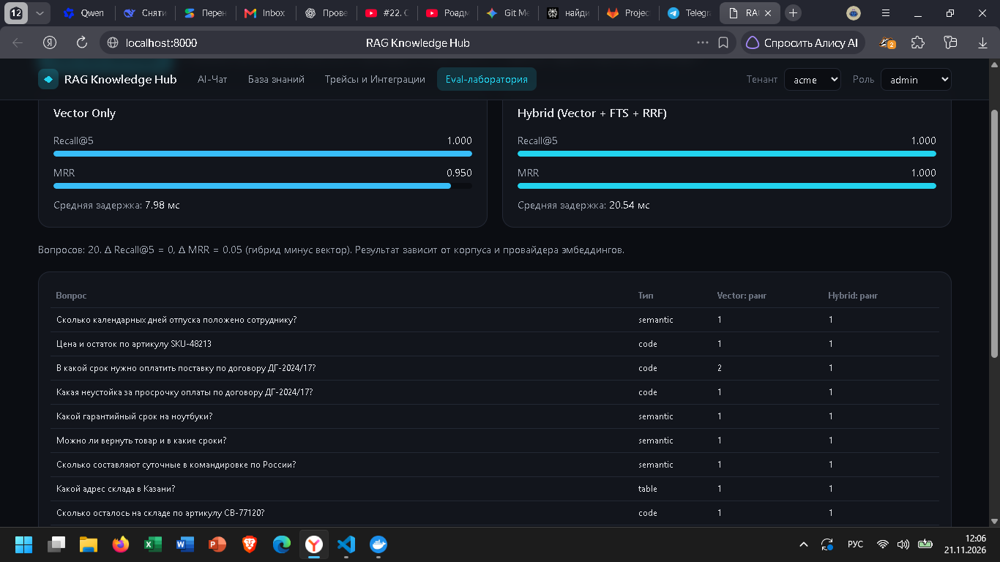
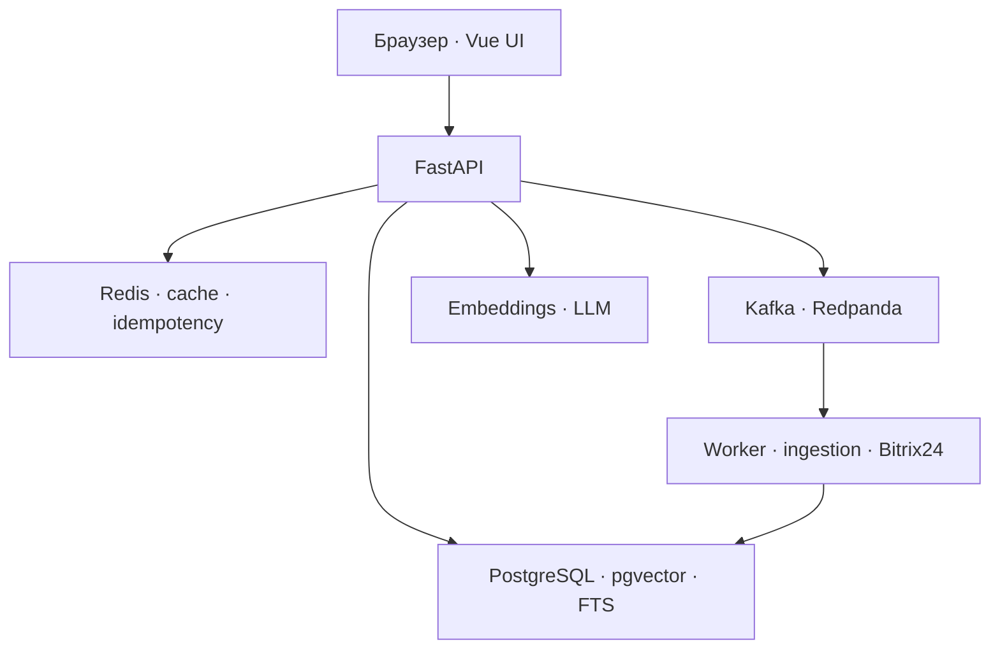

# RAG Knowledge Hub

Веб-сервис корпоративной базы знаний. Загружает документы, индексирует их и отвечает на вопросы с цитатами из источников. Доступ к документам ограничивается по тенанту и роли пользователя.

Поддерживаются PDF, XLSX/XLSM, CSV, DOCX, Markdown и TXT. Для поиска используются векторный поиск в pgvector, полнотекстовый поиск PostgreSQL и объединение результатов через Reciprocal Rank Fusion (RRF).

**English:** A multi-tenant knowledge base service for document ingestion and question answering with source citations. It combines PostgreSQL full-text search, pgvector retrieval and Reciprocal Rank Fusion.

## Быстрый запуск

Нужен установленный Docker Desktop с запущенным Docker Engine.

```powershell
docker compose up -d --build
Start-Process "http://localhost:8000"
```

При первом запуске сервис применит миграции и загрузит демонстрационные документы. Состояние базы сохраняется в Docker volume.

- Веб-интерфейс: [http://localhost:8000](http://localhost:8000)
- API: [http://localhost:8000/docs](http://localhost:8000/docs)
- Готовность сервиса: [http://localhost:8000/ready](http://localhost:8000/ready)

Чтобы остановить сервисы, сохранив данные:

```powershell
docker compose down
```

## Демо-доступ

В демо-режиме интерфейс загружает доступные демо-роли автоматически. В шапке можно переключать тенант и роль.

Доступны два демонстрационных тенанта — `acme` и `globex` — и роли `guest`, `employee`, `manager`, `admin`. Для API можно передавать Bearer-токен, например:

```text
Authorization: Bearer demo-acme-admin
```

Демо-токены предназначены только для демонстрации. Для собственного окружения задайте `RAG_ROLE_TOKENS` и отключите `DEMO_MODE`.

## Интерфейс



## Возможности

- **Загрузка и индексация документов.** Обработка PDF, Excel, CSV, DOCX, Markdown и TXT; сохранение номера страницы, имени листа и пути раздела.
- **Гибридный поиск.** Векторный поиск по pgvector, полнотекстовый поиск PostgreSQL и объединение результатов через RRF.
- **Разграничение доступа.** Tenant и роль берутся из Bearer-токена. Фильтры доступа включены в поисковые SQL-запросы.
- **Чат с источниками.** Ответ содержит цитаты на найденные фрагменты. Если подходящего материала нет, сервис сообщает об отсутствии ответа в документах.
- **Фоновая обработка.** Kafka на базе Redpanda передаёт задачи индексации и события Bitrix24 воркеру.
- **Кэширование и наблюдаемость.** Redis используется для кэша ответов, идемпотентности и ограничения частоты запросов. Запросы сохраняются в трейсы с `X-Request-ID`.
- **Интеграция с Bitrix24.** Входящие события обрабатываются через Kafka; исходящий комментарий по умолчанию работает в режиме dry-run.
- **Eval-лаборатория.** Сравнение режимов поиска на встроенном демонстрационном датасете.

## Архитектура



## Поиск и генерация ответа

Поиск выполняется в несколько этапов:

1. Векторный поиск находит близкие по embedding фрагменты.
2. PostgreSQL FTS ищет совпадения по словам и кодам, включая артикулы и номера договоров.
3. RRF объединяет результаты; дополнительный rerank учитывает совпадение ключевых терминов.
4. Перед формированием ответа применяется проверка релевантности, а найденные фрагменты возвращаются как цитаты.

Без внешних ключей сервис использует локальные 384-мерные hash-эмбеддинги и экстрактивное формирование ответа. Для более качественного семантического поиска можно подключить OpenAI-совместимый embeddings API. Для генерации ответа можно отдельно настроить OpenAI-совместимую LLM.

При подключении внешнего провайдера вопросы и найденные фрагменты документов отправляются этому провайдеру. Учитывайте требования к конфиденциальности данных.

## Настройка провайдеров

Скопируйте `.env.example` в `.env` и при необходимости задайте параметры:

```dotenv
LLM_API_KEY=
LLM_BASE_URL=https://api.openai.com/v1
LLM_MODEL=gpt-4o-mini

EMBEDDING_API_KEY=
EMBEDDING_BASE_URL=https://api.openai.com/v1
EMBEDDING_MODEL=text-embedding-3-small
```

Без ключей используются локальные реализации. Если внешний embeddings-провайдер недоступен, сервис повторяет запросы, а затем передаёт задачу в DLQ; векторы разных моделей не смешиваются.

При смене модели embeddings существующие документы нужно переиндексировать. Повторная загрузка того же файла сама по себе не запускает переиндексацию: сработает проверка SHA-256.

## Уровни доступа

| Роль | Уровень доступа |
|---|---:|
| `guest` | 0 |
| `employee` | 1 |
| `manager` | 2 |
| `admin` | 3 |

Документ доступен пользователю, если его уровень доступа не выше уровня роли. Tenant и роль определяются сервером по токену, а не принимаются из тела запроса.

Для собственного окружения задайте токены в формате:

```dotenv
RAG_ROLE_TOKENS=token-a:acme:admin,token-b:acme:employee
DEMO_MODE=false
```

## API

| Метод | Путь | Доступ |
|---|---|---|
| `GET` | `/health`, `/ready` | Проверка сервиса |
| `POST` | `/api/v1/documents` | `manager` и выше |
| `GET` | `/api/v1/documents` | По tenant и роли |
| `GET` | `/api/v1/documents/{id}` | По tenant и роли |
| `GET` | `/api/v1/documents/{id}/chunks` | По tenant и роли |
| `DELETE` | `/api/v1/documents/{id}` | `admin` |
| `POST` | `/api/v1/chat` | Любая роль |
| `POST` | `/api/v1/chat/stream` | Любая роль, SSE |
| `GET` | `/api/v1/traces`, `/api/v1/traces/stats` | `manager` и выше |
| `GET` | `/api/v1/traces/{id}` | `manager` и выше |
| `POST` | `/api/v1/traces/{id}/feedback` | Любая роль |
| `POST` | `/api/v1/eval/run` | `manager` и выше |
| `POST` | `/api/v1/integrations/bitrix24/webhook` | `application_token` |
| `POST` | `/api/v1/integrations/bitrix24/simulate` | `manager` и выше |
| `GET` | `/api/v1/integrations/events` | `manager` и выше |

Полная схема API и интерактивная документация доступны по адресу [http://localhost:8000/docs](http://localhost:8000/docs).

## Безопасность и ограничения

- Демо-токены и переключение ролей предназначены для демонстрационного режима. Перед использованием в собственном окружении задайте свои токены и установите `DEMO_MODE=false`.
- Фильтр prompt-инъекций удаляет строки, совпавшие с известными шаблонами. Это дополнительная эвристика, а не гарантия защиты от всех вариантов инъекций.
- Локальные hash-эмбеддинги лексические: они не обеспечивают полноценный семантический поиск синонимов.
- PDF извлекается без OCR: сканы без текстового слоя не распознаются. Таблицы PDF извлекаются лучше всего, когда у них есть линии.
- Eval-датасет небольшой и служит для сравнения режимов поиска на демонстрационном корпусе; результаты зависят от документов и выбранной модели.
- Для настоящей отправки комментариев в Bitrix24 задайте `B24_WEBHOOK_URL` и явно отключите dry-run через `B24_DRY_RUN=false`.# RAG Knowledge Hub

Веб-сервис корпоративной базы знаний. Загружает документы, индексирует их и отвечает на вопросы с цитатами из источников. Доступ к документам ограничивается по тенанту и роли пользователя.

Поддерживаются PDF, XLSX/XLSM, CSV, DOCX, Markdown и TXT. Для поиска используются векторный поиск в pgvector, полнотекстовый поиск PostgreSQL и объединение результатов через Reciprocal Rank Fusion (RRF).

**English:** A multi-tenant knowledge base service for document ingestion and question answering with source citations. It combines PostgreSQL full-text search, pgvector retrieval and Reciprocal Rank Fusion.

## Быстрый запуск

Нужен установленный Docker Desktop с запущенным Docker Engine.

```powershell
docker compose up -d --build
Start-Process "http://localhost:8000"
```

При первом запуске сервис применит миграции и загрузит демонстрационные документы. Состояние базы сохраняется в Docker volume.

- Веб-интерфейс: [http://localhost:8000](http://localhost:8000)
- API: [http://localhost:8000/docs](http://localhost:8000/docs)
- Готовность сервиса: [http://localhost:8000/ready](http://localhost:8000/ready)

Чтобы остановить сервисы, сохранив данные:

```powershell
docker compose down
```

## Демо-доступ

В демо-режиме интерфейс загружает доступные демо-роли автоматически. В шапке можно переключать тенант и роль.

Доступны два демонстрационных тенанта — `acme` и `globex` — и роли `guest`, `employee`, `manager`, `admin`. Для API можно передавать Bearer-токен, например:

```text
Authorization: Bearer demo-acme-admin
```

Демо-токены предназначены только для демонстрации. Для собственного окружения задайте `RAG_ROLE_TOKENS` и отключите `DEMO_MODE`.

## Интерфейс


## Возможности

- **Загрузка и индексация документов.** Обработка PDF, Excel, CSV, DOCX, Markdown и TXT; сохранение номера страницы, имени листа и пути раздела.
- **Гибридный поиск.** Векторный поиск по pgvector, полнотекстовый поиск PostgreSQL и объединение результатов через RRF.
- **Разграничение доступа.** Tenant и роль берутся из Bearer-токена. Фильтры доступа включены в поисковые SQL-запросы.
- **Чат с источниками.** Ответ содержит цитаты на найденные фрагменты. Если подходящего материала нет, сервис сообщает об отсутствии ответа в документах.
- **Фоновая обработка.** Kafka на базе Redpanda передаёт задачи индексации и события Bitrix24 воркеру.
- **Кэширование и наблюдаемость.** Redis используется для кэша ответов, идемпотентности и ограничения частоты запросов. Запросы сохраняются в трейсы с `X-Request-ID`.
- **Интеграция с Bitrix24.** Входящие события обрабатываются через Kafka; исходящий комментарий по умолчанию работает в режиме dry-run.
- **Eval-лаборатория.** Сравнение режимов поиска на встроенном демонстрационном датасете.

## Архитектура


## Поиск и генерация ответа

Поиск выполняется в несколько этапов:

1. Векторный поиск находит близкие по embedding фрагменты.
2. PostgreSQL FTS ищет совпадения по словам и кодам, включая артикулы и номера договоров.
3. RRF объединяет результаты; дополнительный rerank учитывает совпадение ключевых терминов.
4. Перед формированием ответа применяется проверка релевантности, а найденные фрагменты возвращаются как цитаты.

Без внешних ключей сервис использует локальные 384-мерные hash-эмбеддинги и экстрактивное формирование ответа. Для более качественного семантического поиска можно подключить OpenAI-совместимый embeddings API. Для генерации ответа можно отдельно настроить OpenAI-совместимую LLM.

При подключении внешнего провайдера вопросы и найденные фрагменты документов отправляются этому провайдеру. Учитывайте требования к конфиденциальности данных.

## Настройка провайдеров

Скопируйте `.env.example` в `.env` и при необходимости задайте параметры:

```dotenv
LLM_API_KEY=
LLM_BASE_URL=https://api.openai.com/v1
LLM_MODEL=gpt-4o-mini

EMBEDDING_API_KEY=
EMBEDDING_BASE_URL=https://api.openai.com/v1
EMBEDDING_MODEL=text-embedding-3-small
```

Без ключей используются локальные реализации. Если внешний embeddings-провайдер недоступен, сервис повторяет запросы, а затем передаёт задачу в DLQ; векторы разных моделей не смешиваются.

При смене модели embeddings существующие документы нужно переиндексировать. Повторная загрузка того же файла сама по себе не запускает переиндексацию: сработает проверка SHA-256.

## Уровни доступа

| Роль | Уровень доступа |
|---|---:|
| `guest` | 0 |
| `employee` | 1 |
| `manager` | 2 |
| `admin` | 3 |

Документ доступен пользователю, если его уровень доступа не выше уровня роли. Tenant и роль определяются сервером по токену, а не принимаются из тела запроса.

Для собственного окружения задайте токены в формате:

```dotenv
RAG_ROLE_TOKENS=token-a:acme:admin,token-b:acme:employee
DEMO_MODE=false
```

## API

| Метод | Путь | Доступ |
|---|---|---|
| `GET` | `/health`, `/ready` | Проверка сервиса |
| `POST` | `/api/v1/documents` | `manager` и выше |
| `GET` | `/api/v1/documents` | По tenant и роли |
| `GET` | `/api/v1/documents/{id}` | По tenant и роли |
| `GET` | `/api/v1/documents/{id}/chunks` | По tenant и роли |
| `DELETE` | `/api/v1/documents/{id}` | `admin` |
| `POST` | `/api/v1/chat` | Любая роль |
| `POST` | `/api/v1/chat/stream` | Любая роль, SSE |
| `GET` | `/api/v1/traces`, `/api/v1/traces/stats` | `manager` и выше |
| `GET` | `/api/v1/traces/{id}` | `manager` и выше |
| `POST` | `/api/v1/traces/{id}/feedback` | Любая роль |
| `POST` | `/api/v1/eval/run` | `manager` и выше |
| `POST` | `/api/v1/integrations/bitrix24/webhook` | `application_token` |
| `POST` | `/api/v1/integrations/bitrix24/simulate` | `manager` и выше |
| `GET` | `/api/v1/integrations/events` | `manager` и выше |

Полная схема API и интерактивная документация доступны по адресу [http://localhost:8000/docs](http://localhost:8000/docs).

## Безопасность и ограничения

- Демо-токены и переключение ролей предназначены для демонстрационного режима. Перед использованием в собственном окружении задайте свои токены и установите `DEMO_MODE=false`.
- Фильтр prompt-инъекций удаляет строки, совпавшие с известными шаблонами. Это дополнительная эвристика, а не гарантия защиты от всех вариантов инъекций.
- Локальные hash-эмбеддинги лексические: они не обеспечивают полноценный семантический поиск синонимов.
- PDF извлекается без OCR: сканы без текстового слоя не распознаются. Таблицы PDF извлекаются лучше всего, когда у них есть линии.
- Eval-датасет небольшой и служит для сравнения режимов поиска на демонстрационном корпусе; результаты зависят от документов и выбранной модели.
- Для настоящей отправки комментариев в Bitrix24 задайте `B24_WEBHOOK_URL` и явно отключите dry-run через `B24_DRY_RUN=false`.
